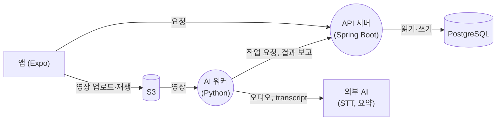

# 우리.zip

매주 하나의 질문에 영상으로 답하며, 떨어져 사는 가족의 얼굴과 목소리, 그리고 이야기를 함께 쌓아 가는 가족 기록 앱입니다.

> 2025 창의설계경진대회 **대상(1등)** 수상작

우리.zip은 캡스톤 디자인 프로젝트로 시작해 2025 창의설계경진대회에서 대상을 받았습니다. 이 저장소는 대회에서 선보인 서비스를 실제 가족이 매주 쓰는 서비스로 완성하기 위해 다시 만드는 리빌드 프로젝트입니다.

리빌드는 기존 구현을 분석해 보완할 점을 찾는 데서 시작했습니다. 문제마다 해결 방법을 비교해 결정 과정을 기록했고, 이 결정대로 만든 뒤 실사용자의 피드백으로 다시 확인합니다.

원본 프로젝트: [Frontend](https://github.com/Capstone-3Team/WooriZip-FE) · [Backend](https://github.com/Capstone-3Team/WooriZip-BE) · [AI](https://github.com/Capstone-3Team/WooriZip-AI)

<br>

## 서비스 소개

### 배경

일과 결혼으로 가족이 여러 곳에 흩어져 살면서, 서로의 일상을 나눌 기회는 점점 줄어듭니다. 명절에 잠깐 얼굴을 보는 것이 전부가 되고, 부모님과 조부모님의 목소리와 말투, 살아온 이야기는 어디에도 남지 않은 채 시간이 흐릅니다.

우리.zip은 가족이 부담 없이 서로의 이야기를 나누고, 그 순간을 영상으로 남겨 언제든 다시 꺼내 볼 수 있게 합니다.

### 주요 기능

#### 1. 매주 도착하는 가족 질문

무슨 이야기를 해야 할지 고민하지 않아도 됩니다. 매주 가족 모두에게 같은 질문이 도착해, 평소에 묻지 못했던 이야기를 자연스럽게 꺼낼 수 있습니다.

#### 2. 영상으로 남기는 답변

글을 쓰는 대신 휴대폰 카메라 앞에서 말로 답합니다. 최대 3분 영상에 표정과 목소리가 그대로 담겨, 사진이나 글로는 남지 않는 그 사람다움을 기록합니다.

#### 3. AI가 정리하는 기록

영상을 올리면 AI가 내용을 듣고 제목과 요약을 쓰고, 가장 잘 나온 장면을 골라 썸네일로 만듭니다. 올린 뒤에는 앱을 닫아도 되고, 정리가 끝나면 알림으로 알려 줍니다.

#### 4. 주차별 보관함

지난 질문과 가족의 답변이 주차별로 차곡차곡 쌓입니다. 시간이 지날수록 우리 가족만의 이야기 보관함이 됩니다.

#### 5. 누구나 쓰기 쉬운 화면

글자, 버튼, 간격이 함께 커지는 화면 크기 3단계를 제공합니다. 연세가 많은 가족도 혼자 답변을 찍고 가족의 이야기를 볼 수 있습니다.

### 이용 흐름

1. 가족 공간을 만들고 초대 코드로 가족을 초대합니다.
2. 매주 새 질문이 도착하면 알림을 받습니다.
3. 질문에 대한 답을 영상으로 찍어 올립니다.
4. AI가 제목, 요약, 썸네일을 만들어 기록을 정리합니다.
5. 가족의 답변을 보고 반응을 남깁니다.
6. 지난 기록은 보관함에서 주차별로 다시 봅니다.

<br>

## 기술 구성



| 영역 | 기술 |
| --- | --- |
| 앱 | Expo, React Native, TypeScript |
| API 서버 | Spring Boot, PostgreSQL, Flyway |
| AI 워커 | Python (STT, 요약 제공자는 평가 중) |
| 인프라 | AWS S3, Parameter Store, GitHub Actions |

<br>

## 문서

| 문서 | 내용 |
| --- | --- |
| [기존 프로젝트 분석](docs/01-legacy-analysis.md) | 기존 구현에서 찾은 보완할 점과 근거 |
| [도메인과 문제 정의](docs/02-domain-and-problem.md) | 서비스가 풀려는 문제, 조건, 기능 단계 |
| [결정 기록 (ADR)](docs/adr/) | 문제마다 무엇을 왜 골랐는지 |
| [아키텍처](docs/03-architecture.md) | 구성 요소, 흐름, 상태 |
| [평가 기준](docs/04-evaluation.md) | 결정이 맞았는지 확인하는 기준 |
| [사용자 흐름](docs/user-flows.md) | 앱의 흐름과 화면 |
| [현황](docs/STATUS.md) | 진행 상태와 로드맵 |
| [작업 계획](docs/plans/) | 작업 단위별 순서, 정한 것, 계획과 달라진 것 |

<br>

## 진행 상황

설계 문서를 마치고 첫 버전(MVP)을 구현하고 있습니다. 2026년 안에 첫 테스트 배포를 하고, 실사용자의 피드백을 반영해 정식 출시까지 진행합니다.

```bash
npm install                                 # 의존성 설치 (Node 24, .nvmrc)
cd infra && docker compose up -d && cd ..   # 로컬 PostgreSQL
npm run mobile:start                        # 모바일 앱

# API 서버 (JDK 25 필요)
apps/api/gradlew -p apps/api bootRun --args='--spring.profiles.active=local'
apps/api/gradlew -p apps/api test           # 테스트 (Docker 필요). API 명세 파일도 새로 씁니다

# 앱용 API 클라이언트
npm run generate --workspace @woorizip/api-client
```

서버 API를 바꾸면 API 서버 테스트와 클라이언트 생성을 다시 실행하고, 바뀐 명세(`packages/api-client/openapi.json`)와 생성된 코드를 함께 커밋합니다. 커밋된 명세나 클라이언트가 서버와 다르면 CI가 실패합니다.

<br>

## 개발 환경 준비

커밋에 비밀값이 들어가지 않도록, 커밋할 때마다 gitleaks로 검사합니다. 저장소를 처음 받으면 gitleaks를 설치하고 저장소의 git hook을 연결합니다.

```bash
brew install gitleaks                       # macOS. 다른 OS는 https://github.com/gitleaks/gitleaks 참고
git config core.hooksPath .githooks         # 커밋 전 검사 연결
```

GitHub에서도 모든 PR과 `main`에 대해 같은 검사를 실행합니다.
