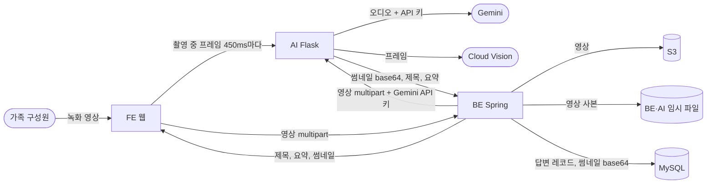

# 기존 프로젝트 분석

리빌드 이전의 팀 프로젝트(WooriZip-FE, WooriZip-BE, WooriZip-AI)가 어떤 구조였고 어떤 문제가 있었는지 정리한다. 문제만 기록하고, 해결 방법은 [ADR](adr/)에서 다룬다.

## 0. 이 문서에 대해

- **분석 방법**: 기존 서버와 운영 데이터가 남아 있지 않아 실행 측정은 할 수 없었다. 세 저장소의 코드와 git 이력을 읽어 문제를 찾았고, 커밋 이력은 당시 겪은 문제를 보여주는 운영 흔적으로 사용했다.
- **기준 커밋**: FE `8d5c92c`, BE `72658f5`, AI `5cb0ff2` (각 main 최신)
- **근거 표기**: `영역 경로:줄`. 경로 기준은 FE·AI는 저장소 루트, BE는 `src/main/java/org/scoula/backend/`(설정 파일은 `resources/`)다. 코드로 확인할 수 없어 추론한 내용은 "추정"으로 표시한다.
- **심각도**: 높음은 데이터 유출·핵심 흐름 실패·전체 장애, 중간은 일부 기능 오동작·운영 비용, 낮음은 유지보수성 문제다.
- **단계**: 문제가 속한 기능의 리빌드 우선순위([STATUS.md](STATUS.md)의 0~3단계)다.

## 1. 기존 프로젝트 개요

| 영역 | 담당 | 기간 | 스택 | 규모 |
| --- | --- | --- | --- | --- |
| FE | 1인 | 2025-11 ~ 2025-12 | React 19, Vite 7, React Router 7, Tailwind CSS 4 (웹) | 화면 47개, 약 1.3만 줄 |
| BE | 1인 | 2025-10 ~ 2025-12 | Java 17, Spring Boot 3.5, JPA·MyBatis 혼용, MySQL 8, JWT, S3 | 엔드포인트 약 55개, 약 4,700줄 |
| AI | 1인 | 2025-10 ~ 2025-12 | Flask 3.0, MediaPipe, Cloud Vision, Gemini 2.5 Flash, ffmpeg | 엔드포인트 5개, 약 1,100줄 |

세 영역을 각각 한 명이 맡아 별도 저장소에서 개발했다. 테스트는 FE 0개, BE 1개(`contextLoads`), AI 0개다.

## 2. 기존 구조

### 핵심 흐름 (as-is)



- 영상 파일이 FE → BE → S3, BE → AI로 서버를 여러 번 통과한다.
- 업로드 요청 하나 안에서 S3 저장, AI 호출 두 개, DB 저장이 모두 끝나야 응답한다.
- AI 서버는 FE(얼굴 가이드)와 BE(분석) 양쪽에서 직접 호출된다.

### 배포 형태

| 영역 | 배포 | 근거 |
| --- | --- | --- |
| BE | GitHub Actions로 Docker 이미지를 빌드해 EC2에 배포, `woorizip.site`로 운영 | `BE .github/workflows/deploy.yml` |
| AI | EC2에 공인 IP와 HTTP로 운영. 배포 설정이 이력에 없어 수동 배포로 추정 | `BE resources/application-prod.properties:31` |
| FE | Vercel 배포를 시도했다가 같은 날 로컬 주소로 되돌림 | FE `5b9c9db` → `9566ee2` |

HTTPS 페이지인 FE가 HTTP인 AI 서버를 직접 호출하면 브라우저가 차단한다(mixed content). 그래서 배포된 FE에서는 촬영 화면이 동작하기 어려웠을 것으로 추정한다. 결국 시연은 세 서버를 모두 로컬에서 띄워 진행했다. 2026-11-19 기준 `woorizip.site`는 응답하지 않고, 운영 DB 주소는 조회되지 않는다.

## 3. 핵심 흐름의 문제

0단계(질문 → 답변 → AI 정리 → 가족이 보기) 범위의 문제다. 표의 근거는 파일 이름만 적었고, 전체 경로와 코드는 아래 항목을 펼치면 볼 수 있다.

| 번호 | 문제 | 근거 | 심각도 | 단계 |
| --- | --- | --- | --- | --- |
| P-01 | API 명세가 없어 세 서비스의 약속이 어긋났다 | `DailyRecords.jsx:111-117`, `PetShortsAiClient.java:51-62` | 높음 | 0 |
| P-02 | 서비스 주소가 코드 여러 곳에 하드코딩되어 있다 | `AiAnalysisService.java:24` | 중간 | 0 |
| P-03 | 세 서비스를 한 번에 띄우는 방법이 없다 | `.gitignore:7-9`, `vite.config.js` | 높음 | 0 |
| P-04 | DB 스키마가 코드에 없다 | `application-prod.properties:6` | 높음 | 0 |
| P-05 | 업로드 요청이 AI 분석이 끝날 때까지 응답하지 않는다 | `VideoAnswerService.java:37-66` | 높음 | 0 |
| P-06 | AI 서버의 결과가 다른 요청과 섞일 수 있다 | `app.py:140,175,205` | 높음 | 0 |
| P-07 | 썸네일 단계가 실패하면 업로드 전체가 실패한다 | `app.py:92-94`, `thumb_stt.py:100` | 높음 | 0 |
| P-08 | 실패해도 남은 파일을 정리하지 않고, 다시 시도할 수 없다 | `VideoAnswerService.java:44-50` | 중간 | 0 |
| P-09 | 일시적인 실패를 확정된 결과로 저장한다 | `AIService.java:58-61`, `PetPostService.java:79-97` | 중간 | 0 |
| P-10 | 앱에서 업로드 실패를 복구할 수 없다 | `VideoProcessingLoading.jsx:79-101` | 높음 | 0 |
| P-11 | 썸네일 이미지를 base64 문자열로 DB에 저장한다 | `VideoAnswerService.java:75` | 중간 | 0 |
| P-12 | JWT 서명 키가 공개 저장소에 있다 | `JwtTokenProvider.java:14` | 높음 | 0 |
| P-13 | 다른 가족의 데이터를 ID로 조회할 수 있다 | `VideoAnswerService.java:173-200`, `MessageService.java:76-83` | 높음 | 0~3 |
| P-14 | 토큰 저장과 만료 처리가 화면마다 다르다 | `Login.jsx:83`, `App.jsx:117-126` | 중간 | 0 |
| P-15 | 비밀번호 재설정과 가입 과정이 취약하다 | `VerificationCodeStore.java:25-53`, `Welcome.jsx:25` | 중간 | 0 |
| P-16 | 지난 주차를 선택해도 이번 주 내용이 나온다 | `WeeklyRecords.jsx:196-201`, `WeekAnswer.jsx:71,229` | 높음 | 0 |
| P-17 | 목록 조회에서 N+1 쿼리가 발생한다 | `VideoAnswerService.java:103-106` | 중간 | 0 |
| P-18 | AI 결과의 품질을 확인할 장치가 없다 | `thumb_stt.py:177,288-307` | 중간 | 0 |
| P-19 | 말한 내용 전체(transcript)를 남기지 않는다 | `thumb_stt.py:285-311` | 중간 | 0, 2 |
| P-20 | 외부 AI 전송 동의와 약관 검토가 없다 | `thumb_stt.py:285-303` | 높음 | 0 |
| P-21 | AI 서버가 인증 없이 공개되어 있었다 | `app.py:26,117,234` | 높음 | 0 |
| P-22 | 정의되지 않은 디자인 토큰이 경고 없이 무시된다 | `Button.jsx:33` | 중간 | 0 |
| P-23 | 연세가 많은 사용자를 위한 대비와 크기가 부족하다 | `index.css:57,137-144`, `BottomNav.jsx:72` | 높음 | 0, 1 |
| P-24 | 로딩과 오류 상태가 없다 | `ArchivePage.jsx:185-187` | 중간 | 0 |
| P-25 | 녹화 형식이 고정되어 일부 기기에서 실패할 수 있다 | `VideoCapturePage.jsx:84-86` | 높음 | 0 |

### 3.1 세 서비스 간 약속

<details>
<summary>P-01. API 명세가 없어 세 서비스의 약속이 어긋났다</summary>

세 서비스가 요청과 응답 형식을 각자 가정했다. FE는 응답 필드 이름을 몰라 후보를 차례로 시도하고, BE는 AI 서버에 존재하지 않는 `/compile`을 호출하는 코드를 갖고 있다. AI README의 엔드포인트와 응답 예시도 실제 코드와 다르다(`AI README.md:137-180`). 한쪽을 고치면 다른 쪽이 깨졌고, 원인을 찾기 어려웠다.

`FE src/pages/daily/DailyRecords.jsx:111-117`

```js
const authorName =
  item.writerNickname ??
  item.nickname ??
  item.familyMemberName ??
  item.authorName ??
  item.writerName ??
  "가족";
```

`BE global/ai/client/PetShortsAiClient.java:51-62` (AI 서버에는 `/compile`이 없다)

```java
public String compilePetShorts(String videoPath, List<List<Double>> segments) {
    String url = flaskUrl + "/compile";
    ...
    ResponseEntity<Map> response = restTemplate.postForEntity(url, payload, Map.class);
```
</details>

<details>
<summary>P-02. 서비스 주소가 코드 여러 곳에 하드코딩되어 있다</summary>

AI 서버 주소가 BE의 세 곳(`AiAnalysisService.java:24`, `PetShortsAiClient.java:23`, `application-prod.properties:31`)에 중복되어 있다. 서버를 옮긴 커밋 `72658f5`("ai 서버 배포 주소 변경")는 세 파일을 함께 고쳤다. FE도 25개 이상 파일이 각자 API 주소를 선언하고, 일부에만 `localhost` 기본값이 있다(`FE src/pages/week-answer/WeekAnswer.jsx:17` 외 4곳).

`BE global/ai/service/AiAnalysisService.java:23-24`

```java
private final WebClient webClient;
private static final String AI_URL = "http://15.164.48.232:8000";
```
</details>

<details>
<summary>P-03. 세 서비스를 한 번에 띄우는 방법이 없다</summary>

전체를 띄우려면 MySQL, BE, AI, FE를 각각 다른 방식으로 준비해야 했고, 실행 방법을 정리한 문서가 없다. BE는 저장소에 없는 설정 파일 세 개가 있어야 실행되고, AI는 Python 버전과 실행 환경이 명시되어 있지 않다. FE는 개발 프록시가 없어 BE의 CORS 설정에 의존한다. 통합 문제를 배포 직전에야 발견했다(4장 배포 재현성).

`BE .gitignore:7-9` (실행에 필요한 설정 파일이 저장소 밖에 있다)

```
/src/main/resources/application.properties
/src/main/resources/application-local.properties
src/main/resources/gcloud-tts-key.json
```

`FE vite.config.js` (프록시 설정 없음)

```js
export default defineConfig({
  plugins: [react(), tailwindcss()],
  resolve: { alias: { "@": fileURLToPath(new URL("./src", import.meta.url)) } },
});
```
</details>

<details>
<summary>P-04. DB 스키마가 코드에 없다</summary>

저장소에 스키마 파일이나 마이그레이션이 없다. 로컬 설정은 `ddl-auto=none`이라 테이블을 직접 만들어야 하고, MyBatis로만 쓰는 테이블(`post`, `post_media`, `post_comment`, `pet_media`)은 JPA 엔티티도 없다. 운영은 엔티티를 보고 테이블을 자동으로 바꾸는 `ddl-auto=update`로 실행했다. 새 환경에서 DB를 재현할 수 없다.

`BE resources/application-prod.properties:6`

```properties
spring.jpa.hibernate.ddl-auto=update
```
</details>

### 3.2 업로드와 AI 분석

<details>
<summary>P-05. 업로드 요청이 AI 분석이 끝날 때까지 응답하지 않는다</summary>

`@Transactional` 메서드 안에서 S3 업로드, 썸네일·요약 AI 호출 두 개, DB 저장을 차례로 처리한 뒤 응답한다. AI 호출은 `.block()`으로 기다리고 타임아웃이 없다. AI가 느리거나 멈추면 요청 스레드와 DB 커넥션이 계속 묶여, 동시 업로드가 몰리면 다른 API까지 멈출 수 있다. FE 로딩 화면에는 취소 버튼이 없어 사용자가 빠져나올 수 없다.

`BE domain/VideoAnswer/service/VideoAnswerService.java:37-66`

```java
@Transactional
public VideoAnswer createVideoAnswer(MultipartFile videoFile, Long questionId, String email) {
    ...
    String s3VideoUrl = s3Uploader.upload(videoFile, "video-answers");
    ...
    CompletableFuture<Map<String, Object>> thumbnailFuture =
        CompletableFuture.supplyAsync(() -> aiAnalysisService.requestThumbnail(tempFile));
    CompletableFuture<Map<String, Object>> sttFuture =
        CompletableFuture.supplyAsync(() -> aiAnalysisService.requestStt(tempFile));

    CompletableFuture.allOf(thumbnailFuture, sttFuture).join();
```

`BE global/ai/service/AiAnalysisService.java:46` (타임아웃 없이 대기)

```java
.block();   // sync
```
</details>

<details>
<summary>P-06. AI 서버의 결과가 다른 요청과 섞일 수 있다</summary>

AI 서버는 작업을 워커 프로세스에 넘기고 공용 결과 큐에서 결과를 꺼낸다. 작업에 id를 붙여 넘기지만, 꺼낼 때는 id를 대조하지 않고 맨 앞의 결과를 가져간다. `/pet_daily`와 `/detect`는 같은 결과 큐를 쓴다. 동시 요청이 오면 다른 사용자의 결과를 받을 수 있고, 워커가 멈추면 타임아웃 없이 무기한 기다린다.

`AI app.py:136-140`

```python
stt_q.put({"id": task_id, "path": temp_path, "api_key": api_key})
...
result = stt_res_q.get()
```

`AI app.py:172-175`, `:202-205` (서로 다른 기능이 같은 결과 큐를 씀)

```python
pet_q.put({"mode": "daily", "path": temp_path})
result = pet_res_q.get()
...
pet_q.put({"mode": "shorts", "path": temp_path})
result = pet_res_q.get()
```
</details>

<details>
<summary>P-07. 썸네일 단계가 실패하면 업로드 전체가 실패한다</summary>

웃는 얼굴 후보를 찾지 못하면 AI 서버가 500을 반환하고, BE는 이를 예외로 받아 답변 생성 전체를 실패시킨다. 최신 main에서는 커밋 `871c646`에서 `vision_client` 정의가 삭제되어, 후보가 있어도 이 단계가 실패한다. 웃는 얼굴이 없는 영상은 답변을 아예 올리지 못할 수 있다(추정, 실행 재현은 하지 못함).

`AI app.py:92-94`

```python
if not result:
    print("❌ [ERROR] find_best_thumbnail() 결과 없음")
    return jsonify({"error": "No valid thumbnail"}), 500
```

`AI models/thumb_stt.py:100` (정의되지 않은 변수)

```python
response = vision_client.batch_annotate_images(requests=requests)
```
</details>

<details>
<summary>P-08. 실패해도 남은 파일을 정리하지 않고, 다시 시도할 수 없다</summary>

S3 업로드가 먼저 끝난 뒤 AI 호출이 실패하면, 트랜잭션은 롤백되지만 S3에 올린 영상은 남는다. AI 처리용 임시 파일은 성공해도 지우지 않는다. 재시도 로직과 중복 방지 키가 없어 클라이언트가 다시 시도하면 같은 답변이 중복 생성될 수 있다. 전역 예외 처리(`@ControllerAdvice`)가 없어 모든 오류가 500으로 나가고, AI 워커의 실패는 HTTP 200에 `error` 필드로 온다(`AI workers/stt_worker.py:43-46`).

`BE domain/VideoAnswer/service/VideoAnswerService.java:44-50`

```java
String s3VideoUrl = s3Uploader.upload(videoFile, "video-answers");

File tempFile;
try {
    tempFile = File.createTempFile("video_", ".mp4");
    videoFile.transferTo(tempFile);
```
</details>

<details>
<summary>P-09. 일시적인 실패를 확정된 결과로 저장한다</summary>

후순위 기능(반려동물)에서 확인된 패턴이지만, 0단계의 분석 실패 처리에도 해당한다. 반려동물 판별 중 오류가 나면 `false`를 반환하고, 이 값이 "반려동물 아님"으로 DB에 저장되어 다시 판별하지 않는다. 또 반려동물 모아보기를 열면(GET), 아직 판별하지 않은 미디어를 그 자리에서 AI 서버로 보낸다. 한 번의 장애가 영구적인 오류 데이터로 남고, 조회가 느려진다.

`BE domain/archive/service/AIService.java:58-61`

```java
} catch (Exception e) {
    System.out.println("🚨 hasPet() 오류: " + e.getMessage());
    return false;
}
```

`BE domain/archive/service/PetPostService.java:84-95` (조회 중 AI 호출 후 결과 저장)

```java
PetMedia cached = petMediaMapper.findByMediaUrl(url);
if (cached == null) {
    boolean isPet = aiService.hasPetFromUrl(url);
    ...
    p.setIsPet(isPet);
    petMediaMapper.insertPetMedia(p);
```
</details>

<details>
<summary>P-10. 앱에서 업로드 실패를 복구할 수 없다</summary>

업로드는 `fetch`로 보내서 진행률을 알 수 없고, 취소와 타임아웃도 없다. 실패하면 오류를 표시한 직후 다음 화면으로 이동해 메시지가 보이지 않는다. 녹화본은 화면 이동 데이터(router state)로만 들고 있어 새로고침하면 사라진다. 분석이 실패한 채 저장 화면으로 넘어가면 "영상 정보가 없어 저장할 수 없습니다"에서 막힌다(`FE src/pages/week-answer/AddVideoAnswer.jsx:189-191`).

`FE src/pages/week-answer/VideoProcessingLoading.jsx:93-101`

```js
} else {
  ...
  setError(`영상 분석에 실패했습니다. (status: ${res.status})`);
}

// 3) 성공이든 실패든 AddVideoAnswer로 이동
navigate("/answers/new", {
```
</details>

<details>
<summary>P-11. 썸네일 이미지를 base64 문자열로 DB에 저장한다</summary>

AI가 돌려준 base64 이미지를 `thumbnailUrl` 컬럼에 그대로 저장하고, 목록 응답에도 포함한다. 답변 목록을 불러올 때마다 이미지 데이터가 함께 전송되어 응답이 커진다. 컬럼 길이에 따라 저장이 실패할 수도 있다(실제 스키마는 확인 불가).

`BE domain/VideoAnswer/service/VideoAnswerService.java:75`

```java
.thumbnailUrl((String) thumbnail.get("image_base64"))
```
</details>

### 3.3 인증과 가족 단위 권한

<details>
<summary>P-12. JWT 서명 키가 공개 저장소에 있다</summary>

JWT 서명 키가 문자열 리터럴로 코드에 있고, 저장소는 공개 상태다. 토큰의 사용자 식별값은 이메일이므로, 이메일만 알면 누구나 그 사용자의 토큰을 만들 수 있었다. 기존 서버가 내려간 지금은 영향이 없지만 같은 키를 다시 쓰면 안 된다.

`BE global/security/JwtTokenProvider.java:14` (키 값은 가림)

```java
private final Key secretKey = Keys.hmacShaKeyFor("<가림>".getBytes());
```
</details>

<details>
<summary>P-13. 다른 가족의 데이터를 ID로 조회할 수 있다</summary>

목록 조회는 로그인한 사용자의 가족으로 거르지만, ID로 단건을 조회하거나 쓰는 API 대부분은 같은 가족인지 확인하지 않는다. 답변 상세, 댓글 조회와 작성(`VideoAnswerCommentService.java:33-34,48-49`), 쪽지 읽기가 그렇고, 사진 목록 쿼리는 모든 가족의 사진을 반환한다(`resources/mapper/PostMapper.xml:89-93`). 다른 가족의 영상, 댓글, 쪽지, 사진이 유출될 수 있다.

`BE domain/VideoAnswer/service/VideoAnswerService.java:173-180` (작성자만 찾고 가족은 비교하지 않음)

```java
public VideoAnswerResponse getVideoById(Long id, String email) {
    FamilyMember member = familyMemberRepository.findByEmail(email)...;
    VideoAnswer answer = videoAnswerRepository.findById(id)...;
    FamilyMember uploader = familyMemberRepository.findById(answer.getFamilyMemberId())...;
    boolean isOwner = uploader.getEmail().equals(email);
```

`BE domain/message/service/MessageService.java:76-83` (받는 사람인지도 확인하지 않고 읽음 처리)

```java
public MessageDetailResponse readMessage(Long messageId) {
    Message msg = messageRepository.findById(messageId)...;
    msg.setIsRead(true);
```
</details>

<details>
<summary>P-14. 토큰 저장과 만료 처리가 화면마다 다르다</summary>

토큰을 `localStorage`에 저장하고 갱신 토큰이 없다(유효시간 1시간). 로그인 여부는 앱을 켤 때 한 번만 확인하고 라우트 보호가 없다. 401 처리는 일부 화면에만 있고, 토큰을 `accessToken`, `token`, `jwt` 세 이름으로 찾는 곳도 있다(`VideoProcessingLoading.jsx:62-65`). 영상을 올리는 도중 토큰이 만료되면 업로드가 실패한다.

`FE src/pages/Login.jsx:82-85`

```js
if (data.token) {
  localStorage.setItem("accessToken", data.token);
}
localStorage.setItem("isLoggedIn", "true");
```

`FE src/App.jsx:117-123` (앱 시작 시 한 번만 확인)

```js
useEffect(() => {
  // 앱이 처음 켜졌을 때만 실행
  const timer = setTimeout(() => {
    const loggedIn = checkIsLoggedIn();
    setIsLoggedIn(loggedIn);
```
</details>

<details>
<summary>P-15. 비밀번호 재설정과 가입 과정이 취약하다</summary>

재설정 인증 코드를 스레드 안전하지 않은 메모리 맵에 저장하고, 예측 가능한 `java.util.Random`으로 만든다. 코드 확인 시도 횟수를 제한하지 않아 6자리 코드를 무차별 대입할 수 있다. 인증을 마친 상태(`isVerified`)는 만료를 확인하지 않으며, 서버를 재시작하면 진행 중인 재설정이 사라진다. 가입 중에는 비밀번호를 화면 이동 데이터(router state)로 넘겨 브라우저 기록에 남는다.

`BE global/verify/VerificationCodeStore.java:25-30,50-53`

```java
private final Map<String, CodeInfo> codeMap = new HashMap<>();
private final Random random = new Random();
...
public boolean isVerified(String email) {
    CodeInfo info = codeMap.get(email);
    return info != null && info.verified;
}
```

`FE src/pages/signup/Welcome.jsx:23-25` (이전 화면에서 받은 비밀번호)

```js
const {
  email,
  password,
```
</details>

### 3.4 보관함

<details>
<summary>P-16. 지난 주차를 선택해도 이번 주 내용이 나온다</summary>

지난 주차 목록에서 질문을 누르면 `questionId`를 넘기지만, 받는 화면은 `readOnly`만 읽고 항상 이번 주 질문을 불러온다. 쌓인 답변을 다시 볼 수 없어, 서비스의 "모아서 보기"가 동작하지 않았다.

`FE src/pages/week-answer/WeeklyRecords.jsx:196-201` (보내는 쪽)

```js
navigate("/week-answer", {
  state: {
    readOnly: true, // 지난 주차는 수정/답변 불가
    questionId: question.id,
  },
});
```

`FE src/pages/week-answer/WeekAnswer.jsx:71`, `:229` (받는 쪽)

```js
const isReadOnly = location.state?.readOnly ?? false;
...
const questionRes = await fetch(`${API_BASE_URL}/question/current`, {
```
</details>

<details>
<summary>P-17. 목록 조회에서 N+1 쿼리가 발생한다</summary>

답변 목록을 만들 때 답변마다 작성자를 따로 조회한다. 보관함 메인도 가족의 게시글 전체를 읽고 게시글마다 작성자와 미디어를 조회한 뒤, 메모리에서 정렬해 3개만 남긴다(`BE domain/archive/service/ArchiveMainService.java:83-134`). 기록이 쌓일수록 조회가 느려진다.

`BE domain/VideoAnswer/service/VideoAnswerService.java:101-106`

```java
List<VideoAnswer> answers = videoAnswerRepository.findByQuestionIdAndFamilyId(questionId, familyId);

return answers.stream()
    .map(answer -> {
        FamilyMember uploader = familyMemberRepository.findById(answer.getFamilyMemberId())
```
</details>

### 3.5 AI 품질과 비용

<details>
<summary>P-18. AI 결과의 품질을 확인할 장치가 없다</summary>

AI 결과를 평가할 데이터와 테스트가 없다. 요약 프롬프트에는 말이 없는 영상을 어떻게 처리할지에 대한 지시가 없고, 출력 형식을 강제하지 않아 코드 블록 표시를 문자열 처리로 걷어낸 뒤 JSON으로 읽는다. 썸네일은 해상도에 따라 달라지는 픽셀 임계값으로 웃는 얼굴을 판정하고, 영상 앞부분 12장만 본다(`thumb_stt.py:223-224`). 모델이나 프롬프트를 바꿔도 좋아졌는지 알 수 없다.

`AI models/thumb_stt.py:174-177`

```python
smile_score = curvature * 0.6 + lip_distance * 0.4

# 🔥 2) 웃음 점수 threshold 약간 상향
return smile_score > 8   # 기존 6 → 8 (웃는 얼굴만 남김)
```

`AI models/thumb_stt.py:306-307`

```python
clean = response.text.strip().lstrip("```json").rstrip("```").strip()
result = json.loads(clean)
```
</details>

<details>
<summary>P-19. 말한 내용 전체(transcript)를 남기지 않는다</summary>

오디오를 LLM에 바로 넣어 한 문장 요약과 제목만 받는다. 별도 STT 단계가 없어 transcript가 생기지 않는다. 요약이 틀렸을 때 원문과 비교할 수 없고, 이후 검색 기능에 쓸 텍스트가 없다.

`AI models/thumb_stt.py:288-311`

```python
prompt = """
이 오디오 내용을 한국어로 한 문장 요약하되,주변 소음보다 발화 내용을 우선으로 내용을 요약하세요.
영상의 주제를 반영한 간결한 제목을 생성하세요.
...
return {
    "summary": result.get("summary", ""),
    "title": result.get("title", "")
}
```
</details>

<details>
<summary>P-20. 외부 AI 전송 동의와 약관 검토가 없다</summary>

가족의 음성을 Gemini API로 보내지만, 가입 약관에 외부 AI 전송 동의가 없다. AI 제공자 약관의 무료 사용분 개인정보 조항과 연령 조항도 고려하지 않았다. 관련 조항은 [02-domain-and-problem.md](02-domain-and-problem.md) 2장에 있다.

`AI models/thumb_stt.py:285,298-303`

```python
model = genai.GenerativeModel("gemini-2.5-flash")
...
response = model.generate_content(
    [
        {"mime_type": "audio/mpeg", "data": audio_bytes},
        prompt
    ]
)
```
</details>

<details>
<summary>P-21. AI 서버가 인증 없이 공개되어 있었다</summary>

AI 서버에 인증이 없고 모든 출처를 허용하며, 업로드 크기 제한 없이 Flask 개발 서버로 `0.0.0.0`에 열려 있었다. Gemini API 키는 BE가 요청마다 HTTP 평문으로 넘겼다(`BE global/ai/service/AiAnalysisService.java:57`). 누구나 외부 AI 호출 비용을 발생시킬 수 있었고, API 키와 가족 영상이 암호화 없이 전송됐다.

`AI app.py:26,117,234`

```python
CORS(app)
...
api_key = request.form.get("api_key")
...
app.run(host="0.0.0.0", port=8000)
```
</details>

### 3.6 화면과 접근성

<details>
<summary>P-22. 정의되지 않은 디자인 토큰이 경고 없이 무시된다</summary>

`text-md`(20곳), `gray-80`(22곳), `gray-10`(15곳), `bg-app`처럼 테마(`FE src/index.css:29-67`)에 정의되지 않은 클래스를 쓴다. Tailwind는 정의되지 않은 클래스를 조용히 무시하므로, 의도한 스타일이 빠져도 알아차리기 어렵다. 비활성 버튼은 배경과 글자색이 같아 글자가 보이지 않는다.

`FE src/components/buttons/Button.jsx:33`

```js
variantClass = "bg-gray-60 text-gray-60 border-gray-60 cursor-not-allowed";
```
</details>

<details>
<summary>P-23. 연세가 많은 사용자를 위한 대비와 크기가 부족하다</summary>

보조 글자색 `#828282`는 배경 대비 약 3.8:1로 WCAG AA 기준(4.5:1)에 못 미친다. 하단 메뉴 글자는 10px이다. 큰 글자 모드는 `xs`~`xl` 글자 크기만 키우고, 간격, 버튼, 아이콘, 그보다 큰 글자는 그대로 둔다. 문서 언어도 `en`으로 지정되어 있다(`FE index.html:2`).

`FE src/index.css:137-144` (큰 글자 모드)

```css
html.text-size-large {
  --text-xs: 1rem;
  --text-sm: 1.125rem;
  --text-base: 1.25rem;
  --text-lg: 1.5rem;
  --text-xl: 1.75rem;
}
```

`FE src/layouts/BottomNav.jsx:72`

```jsx
<span className="text-[10px] leading-tight">
```
</details>

<details>
<summary>P-24. 로딩과 오류 상태가 없다</summary>

보관함 화면에는 로딩 상태가 없고, 불러오기에 실패하면 콘솔에만 기록해 사용자에게는 빈 화면이 보인다. 다른 화면의 오류 안내도 대부분 `alert`(20곳)에 의존한다.

`FE src/pages/archive/ArchivePage.jsx:185-187`

```js
} catch (e) {
  console.error(e);
}
```
</details>

<details>
<summary>P-25. 녹화 형식이 고정되어 일부 기기에서 실패할 수 있다</summary>

녹화 형식을 webm(vp8)으로 고정하고, 기기가 지원하는지 확인하지 않는다. webm 녹화를 지원하지 않는 iPhone Safari에서는 녹화가 실패할 수 있다(추정, 실기기 확인은 하지 못함). 카메라는 HTTPS나 localhost에서만 열려, 개발 중 휴대폰으로 테스트하기도 어려웠다.

`FE src/pages/week-answer/VideoCapturePage.jsx:84-86`

```js
const recorder = new MediaRecorder(streamRef.current, {
  mimeType: "video/webm;codecs=vp8",
});
```
</details>

## 4. 운영과 보안

### 저장소에 커밋된 비밀값

세 저장소는 모두 공개 상태다. 값과 위치는 적지 않고 종류와 조치 상태만 기록한다.

| 비밀값 | 위치 | 상태 (2026-11-19) |
| --- | --- | --- |
| AWS 액세스 키 | AI 저장소의 추적 중인 설정 파일 | BE 로컬 설정의 S3 키와 같은 키로, BE 담당자 계정의 키임을 확인. 폐기 회신 대기 |
| JWT 서명 키 | BE 소스 코드 | P-12 참고 |
| 운영 DB 비밀번호 | BE git 이력 | 운영 DB 주소가 조회되지 않음. 인스턴스 삭제로 추정 |
| 메일 계정 비밀번호 | BE git 이력 | 확인 중 |
| GCP 서비스계정 키 | BE CI가 Docker 이미지에 포함 | 이미지 저장소 공개 여부 확인 중 |
| 카카오 JS 키, 서버 주소 | FE git 이력 | 브라우저에 노출되는 키. 허용 도메인 확인 필요 |

- 비밀값을 넣었다가 추적을 해제하는 커밋이 BE(`808cd1c`, `1fb5469`)와 FE(`1f3f2b9`)에 반복된다. 추적을 해제해도 이전 커밋에는 값이 남는다.
- AWS 키를 커밋할 때 GitHub 푸시 보호가 차단했지만 우회하고 올렸다(비밀값 스캔 경고의 `push_protection_bypassed: true`). 도구가 막았는데도 우회할 만큼 비밀값 관리 기준이 없었다.

### 배포 재현성

- BE는 2025-12-04 하루에 배포 관련 수정 커밋이 약 20개 몰려 있다. CI 설정 3회 연속 실패, CORS 4회, MyBatis 매퍼 경로 4회, HTTPS 처리 3회다.
- 로컬과 운영 설정이 달라 운영에서만 생기는 버그가 있다. `map-underscore-to-camel-case`가 로컬에만 있어 운영에서는 일부 조회 결과의 필드가 비게 된다(추정).
- AI 서버는 CPU 전용 서버에서 GPU 설정과 모델 옵션을 바꾸는 커밋이 2025-12-05 오전에 약 16개 몰려 있다.
- BE CI는 테스트를 건너뛰고 빌드한다(`BE .github/workflows/deploy.yml:29`, `-x test`). 로깅은 `System.out.println`과 `print`에 의존한다.

## 5. 범위 문제

기존 프로젝트는 화면 47개 규모로 기능을 넓혔지만, 상당수가 미완성이거나 가짜 응답으로 동작했다.

| 기능 | 상태 | 근거 |
| --- | --- | --- |
| 카카오 로그인 | 항상 고정된 응답을 반환하는 가짜 구현, SDK 초기화는 주석 처리 | `FE src/pages/Login.jsx:97-108`, `FE src/main.jsx:8-12` |
| 이메일 변경 | 가짜 구현 | `FE src/pages/mypage/EditEmailPage.jsx:19-23` |
| 음성 성별 설정 | 화면만 있고 동작하지 않음 | `FE src/pages/mypage/TTSVoiceSettingsPage.jsx:15-17` |
| 회원 탈퇴 | 미구현 | `FE src/pages/mypage/ProfileSettingsPage.jsx:196-199` |
| 반려동물 숏츠 | 반려동물이 나왔다 사라지는 영상은 오타로 항상 실패 | `AI models/pet_shorts.py:103` (`r["time_time"]`) |
| 반려동물 모아보기 | 인증 필터 설정이 어긋나 오류가 날 것으로 추정 | `BE global/security/JwtAuthenticationFilter.java:43`, `BE domain/archive/controller/PetPostController.java:36` |
| 갤러리 | 가족 구분 없는 데모용 코드가 남아 있음 | `BE domain/archive/service/GalleryService.java:24` |

## 6. 참고할 기존 설계

의도가 분명했던 설계다. 그대로 가져간다는 뜻이 아니라, ADR에서 대안과 함께 비교할 후보로 기록한다.

| 기존 설계 | 내용 | 해결하려던 문제 | 리빌드에서 검토할 것 | 단계 | 근거 |
| --- | --- | --- | --- | --- | --- |
| 썸네일 2단계 거르기 | 로컬에서 흐린 프레임과 얼굴을 먼저 거르고, 유료 Vision API는 후보 최대 12장에만 호출 | Vision API 호출 비용 | 웃는 얼굴 판정 같은 거르기 기준이 맞는지, 유료 API 없이도 되는지. 평가셋으로 비교 | 0 | `AI models/thumb_stt.py:85-100,135-177,223-224` |
| 오디오만 보내 요약 | 영상 대신 오디오를 추출하고 1.2배속으로 줄여 LLM에 전달 | 토큰 수와 비용 | STT를 따로 두면 배속이 정확도를 떨어뜨리는지 | 0 | `AI models/thumb_stt.py:258-266` |
| 커밋 후 비동기 실행 | 트랜잭션 커밋 이후에 별도 빈의 `@Async`로 후속 작업 실행 | 커밋 전 데이터 읽기, 같은 클래스 안에서 부르면 `@Async`가 무시되는 문제 | 서버가 재시작되면 실행 중인 작업이 사라짐. 작업 테이블, 큐와 비교 | 0 | `BE domain/VideoAnswer/service/VideoAnswerService.java:84-89` |
| 처리 상태값 | `PENDING`, `PROCESSING`, `DONE`, `FAILED` | 진행 상태 표시 | 분석 단계별 상태가 따로 필요한지 | 0 | `BE domain/VideoAnswer/service/PetShortsAsyncService.java:36-79` |
| 가족은 서버가 결정 | 목록 조회 시 클라이언트 값이 아니라 토큰의 사용자로 가족을 정함 | 클라이언트가 보낸 값의 위조 | 단건 조회까지 빠짐없이 적용할 방법 | 0 | `BE domain/VideoAnswer/service/VideoAnswerService.java:100` |
| AI 추천값 수정 | AI가 고른 제목, 요약, 썸네일을 사용자가 고쳐서 올림 | AI 결과 오류 | 0단계 수정 범위(제목, 요약) | 0 | `FE src/pages/week-answer/AddVideoAnswer.jsx:258-319` |
| 상황별 빈 화면 | 가족이 없으면 초대, 답변이 없으면 첫 답변 안내 | 처음 쓰는 사용자 안내 | 공통 상태 컴포넌트로 통합 | 0 | `FE src/pages/week-answer/WeekAnswer.jsx:379-403` |
| 초대 공유 | 공유 시트를 쓰고, 지원하지 않으면 클립보드로 대체 | 가족 초대 | 앱 공유 시트와 딥링크로 옮기기 | 0, 1 | `FE src/utils/shareFamilyInvite.js:8-39` |
| 얼굴 가이드 규칙 | CPU에서 가볍게 도는 규칙 기반 판정, 배경 인물 거르기, 연속 실패 기준 | 촬영 구도 | 서버 호출 대신 기기 안에서 처리할지 | 1 | `AI models/face_arrange.py:13-14,51-66,124-131` |
| 얼굴 가이드 음성 안내 | 상태가 바뀔 때만 안내하고 재생 간격을 둠 | 화면을 보기 어려운 상황 | 녹화 중 안내 음성이 함께 녹음되는 문제 | 1 | `FE src/pages/week-answer/VideoCapturePage.jsx:117-157` |

## 부록 A. 후순위 기능에서 발견한 문제

0단계에서 만들지 않는 기능(1~3단계)의 문제다. 해당 기능을 만들 때 참고한다. 0단계에도 적용되는 패턴은 P-09에 함께 적었다.

| 문제 | 근거 | 단계 |
| --- | --- | --- |
| 구성원별 보관함이 질문마다 답변 API를 따로 호출하고, 올해 질문만 대상으로 함 | `FE src/pages/archive/MemberArchivePage.jsx:145-185` | 1 |
| 댓글의 "내 댓글" 여부가 항상 참 (`member.getEmail().equals(member.getEmail())`) | `BE domain/VideoAnswer/service/VideoAnswerCommentService.java:56` | 1 |
| 이메일을 바꾸면 토큰의 사용자 식별값(이메일)과 맞지 않아 이후 요청이 실패 | `BE domain/mypage/service/MyPageService.java:62-71` | 1 |
| 반려동물 판정 결과가 다른 프레임의 시각에 붙음 (`zip(as_completed(futures), frames)`) | `AI models/pet_shorts.py:89`, `AI models/pet_daily.py:90` | 3 |
| 반려동물 판별이 영상 1초마다 Vision API를 호출해 비용 상한이 없음 | `AI models/pet_daily.py:81`, `AI models/pet_shorts.py:84` | 3 |
| 반려동물 숏츠에 소리가 없음 | `AI models/pet_shorts.py:141` (`a=0`) | 3 |
| 숏츠 생성이 실패하거나 서버 재시작으로 멈추면 다시 시도할 경로가 없음 | `BE domain/VideoAnswer/service/PetShortsAsyncService.java:70-80` | 3 |
| 일상 피드에서 다른 사람의 글에도 수정·삭제 메뉴가 보임 | `FE src/pages/daily/DailyRecords.jsx:583-584` | 3 |
| 게시글 생성에 트랜잭션이 없어 일부만 저장될 수 있음 | `BE domain/post/service/PostService.java:71-103` | 3 |

## 부록 B. 확인하지 못한 것

- 커밋된 비밀값이 아직 유효한지
- BE Docker 이미지 저장소의 공개 여부
- 실제 EC2에서 실행된 AI 코드의 버전
- 실제 응답 시간과 오류율 (운영 데이터 없음)
- iPhone Safari에서의 녹화 실패 여부 (실기기 확인 안 함)
- 기존 프로젝트가 Gemini API를 유료로 사용했는지
- Vercel 프로젝트 설정
