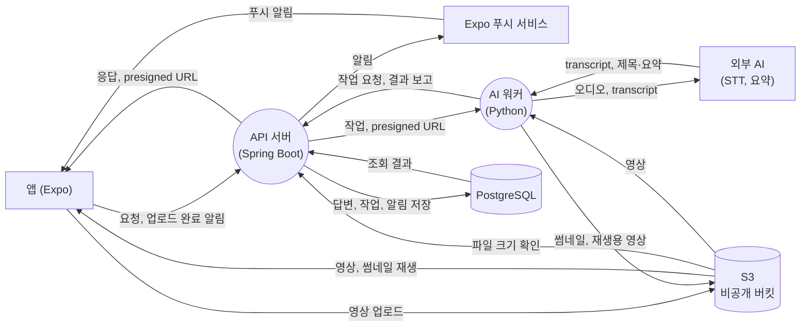
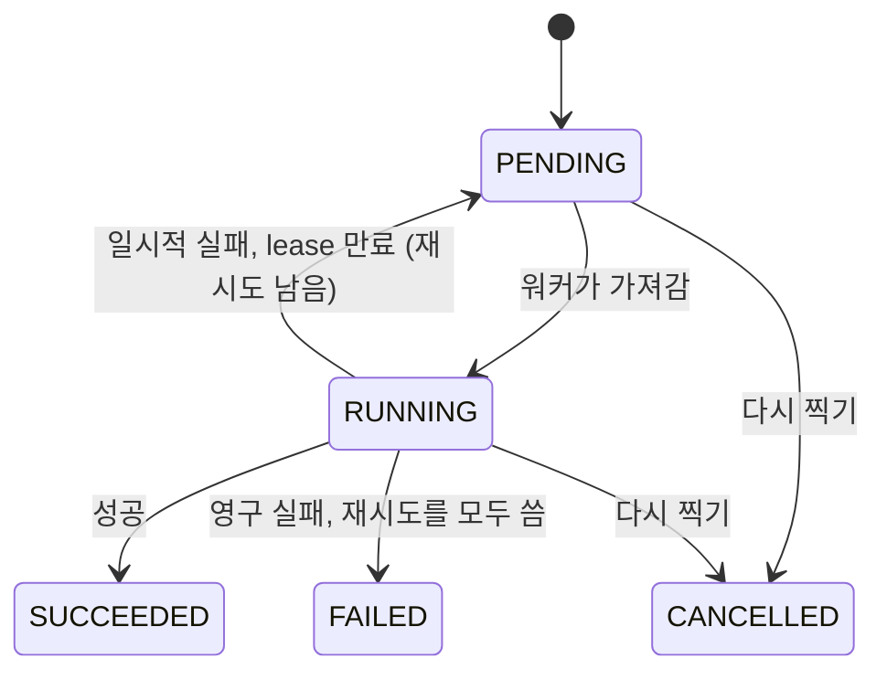
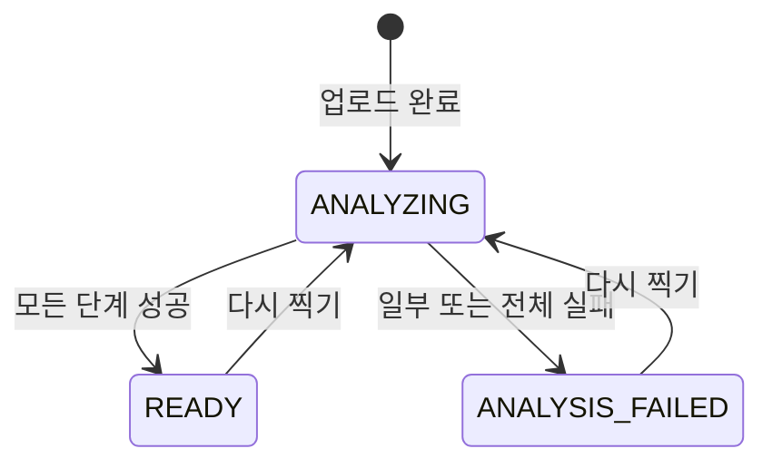

# 아키텍처

이 문서는 채택한 ADR에 따라 시스템의 구성 요소가 어떻게 맞물리는지 정리한다. 무엇을 왜 골랐는지는 각 ADR에 있고, 이 문서는 그 결정의 구체적인 모양(구성, 흐름, 표, 상태)을 다룬다. ADR이 "03에서 정한다"고 넘긴 항목도 여기서 정한다.

- 범위는 0단계다. 이후 단계에 필요한 구조는 해당 단계를 표시해 둔다.
- 아직 정하지 않은 결정은 12장에 모은다. 배포 형태(ADR 0017)가 정해지기 전이라 서버 대수, 네트워크, 모니터링은 다루지 않는다.
- 숫자로 적은 값(시간, 횟수)은 출발점이다. 구현하면서 실측한 값을 보고 조정한다.

## 1. 전체 구성

데이터 흐름도(DFD) 형식으로 그린다. 사각형은 외부 개체, 원은 처리, 원통은 저장소, 화살표는 오가는 데이터다. 모든 통신은 HTTPS이고, AI 워커와 API 서버 사이는 내부 API다(작업 요청은 long polling).



| 원칙 | 근거 |
| --- | --- |
| 앱이 부르는 서버는 API 서버 하나다. AI 워커에는 들어오는 포트가 없고, 워커가 API 서버에 먼저 요청한다 | [0002](adr/0002-async-analysis.md), [0005](adr/0005-service-communication.md), [0011](adr/0011-ai-worker-framework.md) |
| DB는 API 서버만 쓴다. AI 워커는 내부 API로 작업을 받고 결과를 보고한다. 서비스 간 약속은 DB 스키마가 아니라 OpenAPI 명세다 | [0002](adr/0002-async-analysis.md), [0006](adr/0006-repository-and-api-contract.md) |
| 영상 파일은 API 서버를 지나지 않는다. API 서버는 누가 어디에 올리고 읽을 수 있는지만 정한다 | [0003](adr/0003-video-upload.md) |
| 오래 걸리거나 실패할 수 있는 일(분석, 푸시 발송)은 요청 안에서 하지 않고 DB에 작업으로 남긴다 | [0002](adr/0002-async-analysis.md), [0004](adr/0004-failure-and-retry.md) |
| 가족 데이터는 가족 경로 아래에서 구성원 확인을 거친 요청만 읽고 쓴다 | [0008](adr/0008-family-authorization.md) |

메시지 큐(SQS)와 Outbox는 쓰지 않는다. 분석 작업과 푸시 발송 모두 DB의 작업 표로 처리한다. 규모가 커져 큐가 필요해지면 옮긴다([0002](adr/0002-async-analysis.md)).

## 2. 구성 요소와 기술

| 영역 | 기술 | 근거 |
| --- | --- | --- |
| 앱 | Expo, React Native, TypeScript | [0007](adr/0007-client-platform.md) |
| 웹 (2단계) | React, TypeScript. 프레임워크는 웹을 만들 때 정한다 | [0007](adr/0007-client-platform.md) |
| 공유 패키지 | `packages/design-tokens`, `packages/api-client`(생성 코드), `packages/core`(검증 스키마, 도메인 상수, 포맷터) | [0006](adr/0006-repository-and-api-contract.md) |
| API 서버 | Spring Boot, Java, Gradle. 기존 프로젝트와 같은 스택을 유지한다. 버전은 구현을 시작할 때의 LTS로 정한다 | 별도 ADR 없음 |
| 인증 | Spring Security, JWT access token, refresh token rotation | [0009](adr/0009-auth-token.md) |
| DB와 조회 | PostgreSQL, Flyway, JPA(`ddl-auto=validate`). 2단계에 pgvector | [0010](adr/0010-database-and-schema.md) |
| API 명세 | springdoc-openapi로 생성. 명세에서 TypeScript, Python 클라이언트를 생성 | [0006](adr/0006-repository-and-api-contract.md) |
| AI 워커 | Python, 프레임워크 없는 워커, 생성된 Python 클라이언트 | [0011](adr/0011-ai-worker-framework.md) |
| AI 제공자 | STT, 요약 모두 평가 중 | [0012](adr/0012-ai-provider.md) (제안) |
| 파일 저장 | S3 비공개 버킷, presigned URL | [0003](adr/0003-video-upload.md) |
| 푸시 알림 | Expo 푸시 서비스, `expo-notifications` | [0007](adr/0007-client-platform.md) |
| 메일 | Amazon SES (서울 리전, IAM 역할로 API 호출) | [0018](adr/0018-email-delivery.md) |
| 비밀값 | AWS Systems Manager Parameter Store(SecureString) | [0014](adr/0014-secrets-and-config.md) |
| 로컬 실행, 테스트 | Docker Compose, Testcontainers, 개발용 S3 버킷 | [0016](adr/0016-local-and-test.md) |
| 배포 | ADR 0017에서 정한다 | 0017 (작성 전) |

## 3. 도메인 모델

| 도메인 | 의미 | 단계 |
| --- | --- | --- |
| User | 서비스 계정. 가입 때 받은 이름, 화면 크기 | 0 |
| UserIdentity | 로그인 수단. 0단계는 이메일(비밀번호 해시), 1단계에 카카오, 구글, 애플 | 0 |
| Family | 가족 공간, 초대 코드 | 0 |
| Member | 사용자의 가족 소속. 역할(방장, 구성원), 가족 안에서 보이는 이름과 호칭, 상태(활성, 떠남) | 0 |
| Question | 질문 은행 | 0 |
| FamilyQuestion | 가족별 주차 질문 배정 | 0 |
| UploadSession | 영상 업로드 한 건. 업로드 주소, 만료 시각, 완료 여부 | 0 |
| Answer | 구성원이 질문에 남긴 영상 답변. 현재 영상, 제목, 요약, 썸네일, 분석 상태 | 0 |
| AnalysisJob | 답변의 영상 하나에 대한 분석 작업. 시도 번호, lease, 재시도 예정 시각 | 0 |
| Reaction | 답변에 대한 반응. 구성원당 답변 하나에 반응 하나 | 0 |
| PushDevice | 푸시 알림을 받을 기기 토큰 | 0 |
| PushDelivery | 보낼 푸시 알림 한 건. 받는 사람, 내용, 발송 상태 | 0 |
| Comment | 답변에 달린 댓글 | 1 |
| Notification | 앱 안의 알림 목록, 알림 설정 | 1 |

refresh token과 비밀번호 재설정 코드는 도메인이 아닌 인증 구현 표로 둔다([0009](adr/0009-auth-token.md)).

나눈 이유:

- **User와 Member**: 인증은 User, 가족 리소스 권한은 Member로 판단한다([0008](adr/0008-family-authorization.md)). 답변, 반응, 댓글, 푸시 수신자는 User가 아니라 Member를 가리킨다. 가족 안에서 보이는 이름과 사진도 Member에 두어, 3단계에 여러 가족에 속하면 가족마다 다르게 보일 수 있다. 가입할 때는 가족에 들어가기 전에 이름을 받으므로, 그 이름은 User에 두고 가족에 들어갈 때 구성원 이름의 처음 값으로 쓴다.
- **User와 UserIdentity**: 한 계정이 여러 로그인 수단을 가진다. 1단계에 소셜 로그인을 넣을 때 표를 바꾸지 않는다.
- **Question과 FamilyQuestion**: 가족마다 시작 시점이 달라 같은 "1주차"라도 배정이 다르다. 2단계의 질문 추천도 이 구조 위에서 동작한다.
- **UploadSession과 Answer**: 업로드 중인 상태는 세션이 갖는다. 답변은 업로드가 끝나 서버가 파일을 확인한 뒤에야 생기므로, 답변에 "업로드 중" 상태가 없다([0003](adr/0003-video-upload.md)).
- **Answer와 AnalysisJob**: 재시도와 다시 찍기로 답변 하나에 작업이 여러 개 생긴다. 시도 횟수 같은 운영 데이터는 답변의 내용과 성격이 다르다.

## 4. 영상 업로드

[0003](adr/0003-video-upload.md)과 [0004](adr/0004-failure-and-retry.md)를 구체화한다.

```txt
1. 앱 → API: 업로드 세션 요청
     POST /families/{familyId}/upload-sessions
     (질문, 다시 찍기면 기존 답변)
2. API: 구성원 확인(0008), 다시 찍기 횟수 확인(하루 20회, 0004)
     → UploadSession 저장 (만료 15분)
     → presigned POST 발급 (파일 키 하나, 크기 범위, Content-Type video/mp4)
3. 앱 → S3: 직접 업로드, 진행률 표시. 실패하면 녹화본을 기기에 두고 "다시 올리기"
4. 앱 → API: 업로드 완료 알림
     POST /families/{familyId}/upload-sessions/{sessionId}/complete
5. API: S3에서 파일 존재와 크기 확인
     → 한 트랜잭션으로:
        UploadSession 완료 표시
        Answer 생성 (다시 찍기면 현재 영상 교체)
        이전 영상의 작업 취소
        AnalysisJob 생성 (대기)
     → 답변을 응답 (분석 중)
6. 앱: 서버가 완료를 확인한 뒤에 기기의 녹화본을 지운다
```

- **완료 알림 중복**: 이미 완료된 세션으로 다시 알리면 새로 만들지 않고 그 세션의 답변을 그대로 돌려준다. 앱은 응답을 받지 못했을 때 안심하고 다시 보낼 수 있다.
- **완료되지 않은 세션**: 만료된 세션으로는 완료를 알릴 수 없다. S3에 남은 파일은 수명 주기 규칙으로 지운다. 완료된 파일이 이 규칙에 걸리지 않게 하는 방법(경로 분리 또는 객체 태그)은 구현할 때 정한다.
- **형식 확인 위치**: [0007](adr/0007-client-platform.md)이 "03에서 정한다"고 넘긴 항목이다. 완료 확인(5번)에서는 크기와 Content-Type만 본다. 코덱, 해상도, 길이는 파일을 읽어야 알 수 있으므로 AI 워커의 첫 단계에서 확인한다(6장). API 서버가 영상 파일을 읽지 않는다는 0003의 기준을 지키기 위해서다.
- **다시 찍기 횟수**: 업로드 세션을 발급할 때 센다. 업로드를 시작하지 않은 세션도 한 번으로 센다.

## 5. 분석 작업

[0002](adr/0002-async-analysis.md)와 [0004](adr/0004-failure-and-retry.md)가 "03에서 정한다"고 넘긴 작업 표, 내부 API, 상태 전이를 정한다.

### 작업 표

| 컬럼 | 의미 |
| --- | --- |
| `id` | 작업 ID |
| `answer_id`, `family_id` | 대상 답변과 가족 |
| `video_key` | 분석할 영상의 S3 키. 다시 찍으면 새 작업이 생긴다 |
| `status` | `PENDING`, `RUNNING`, `SUCCEEDED`, `FAILED`, `CANCELLED` |
| `attempt` | 시도 번호. 워커에 넘길 때마다 1씩 올린다. fencing token으로 쓴다 |
| `lease_until` | 이 시각까지 결과가 오지 않으면 시도를 실패로 본다 |
| `run_after` | 이 시각 이후에 워커에 넘길 수 있다. 재시도 간격에 쓴다 |
| `last_error_kind`, `last_error` | 마지막 실패의 종류(일시적, 영구)와 내용 |
| `model_versions`, `prompt_version` | 결과를 만든 모델과 프롬프트 버전. AI 품질 평가(ADR 0013)에 쓴다 |

답변에는 지금 분석 대상인 작업(`current_job_id`)을 둔다.

### 내부 API

AI 워커만 부르는 API다. 공개 API와 경로를 나누고, 인증 방식은 [0005](adr/0005-service-communication.md)에서 확정한다.

**작업 요청** `POST /internal/analysis-jobs/claim`

```sql
-- 꺼낼 작업 하나를 잠근다. 다른 워커가 잠근 행은 건너뛴다.
SELECT id FROM analysis_jobs
WHERE status = 'PENDING' AND run_after <= now()
ORDER BY run_after
LIMIT 1
FOR UPDATE SKIP LOCKED;

-- 같은 트랜잭션에서 넘긴다고 표시한다.
UPDATE analysis_jobs
SET status = 'RUNNING', attempt = attempt + 1, lease_until = now() + :lease
WHERE id = :id;
```

- 꺼낼 작업이 없으면 응답을 최대 20초 붙잡고 짧은 간격으로 다시 확인한다(long polling). 그동안 작업이 생기면 바로 응답하고, 끝내 없으면 빈 응답을 돌려준다.
- 응답에는 작업 ID, 시도 번호, lease 만료 시각, 질문 문구와 함께 presigned URL을 담는다. 영상 읽기용, 썸네일 쓰기용, 재생용 영상 쓰기용이다. 워커는 저장소 키를 갖지 않는다([0003](adr/0003-video-upload.md)).
- lease는 15분에서 시작한다. 3분 영상의 분석 시간 목표(5분 이내, [04-evaluation.md](04-evaluation.md))보다 넉넉하게 잡고, 실측 후 조정한다. presigned URL의 만료도 lease와 같게 둔다.

**결과 보고** `POST /internal/analysis-jobs/{jobId}/result`

- 워커는 시도 번호와 단계별 결과(성공한 단계의 결과, 실패한 단계의 실패 종류)를 보낸다.
- API 서버는 작업이 `RUNNING`이고 보고된 시도 번호가 현재 시도 번호와 같을 때만 받는다. 아니면 409를 돌려주고, 워커는 그 결과를 버린다. lease가 만료된 뒤 늦게 온 결과와, 다시 찍기로 취소된 이전 영상의 결과를 이 한 규칙으로 함께 거른다([0004](adr/0004-failure-and-retry.md)의 3번).

### 작업 상태



- 재시도는 첫 시도 뒤 최대 3회이고, 1분, 5분, 15분 뒤로 `run_after`를 정한다([0004](adr/0004-failure-and-retry.md)).
- lease 만료는 API 서버의 스케줄러가 주기적으로 찾아 일시적 실패와 같게 처리한다. lease 만료도 시도 한 번으로 센다.
- 한 시도에서 워커는 모든 단계를 실행한다. 일부 단계가 일시적으로 실패하면 다음 시도에서 전체를 다시 실행한다. 일시적 실패는 재시도가 끝나기 전까지 결과로 저장하지 않는다(P-09).
- 작업이 `SUCCEEDED`나 `FAILED`로 끝나면, 마지막 시도에서 성공한 단계의 결과를 답변에 반영하고 실패한 단계는 기본값으로 채운다.

### 답변의 분석 상태



`ANALYSIS_FAILED`인 답변도 영상은 재생되고, 실패한 항목은 기본값으로 채운다.

- 답변은 세 상태 모두 가족에게 보인다. 분석 중에는 "AI 분석 중"을 보여준다.
- 기본값: 제목은 질문 문구, 썸네일은 기본 이미지, 요약은 비워 둔다. 작성자는 직접 고칠 수 있다(0단계 기능).
- 작성자가 직접 고친 제목과 요약은 이후 분석 결과로 덮어쓰지 않는다.
- `ANALYZING`인 답변이 화면에 있으면 앱이 polling한다. `READY`나 `ANALYSIS_FAILED`가 되면 멈춘다([0002](adr/0002-async-analysis.md)).

## 6. 분석 단계

AI 워커의 단계다([0011](adr/0011-ai-worker-framework.md)). 단계마다 인터페이스를 두어 제공자를 바꿔 끼운다.

| 단계 | 입력 | 출력 | 실패 시 | 단계 |
| --- | --- | --- | --- | --- |
| PROBE | 영상 | 코덱, 해상도, 길이 | 파일을 읽을 수 없으면 영구 실패 | 0 |
| TRANSCODE | 영상 | 재생용 영상(H.264 mp4, 720p) | 원본으로 재생 | 0, 조건부 |
| TRANSCRIBE | 영상의 오디오 | transcript | 요약도 할 수 없음 | 0 |
| SUMMARIZE | transcript, 질문 문구 | 제목, 요약 | 기본값 | 0 |
| THUMBNAIL | 영상 프레임 | 썸네일 이미지 | 기본 이미지 | 0 |
| EMBED | transcript, 요약 | 벡터 | 검색 대상에서만 빠짐 | 2 |

- **TRANSCODE**: PROBE 결과가 H.264 mp4, 720p가 아닐 때만 실행한다. 앱이 형식을 지켜 찍으면 실행되지 않는다. 기기마다 형식이 지켜지는지는 [0007](adr/0007-client-platform.md)의 실기기 확인으로 본다. 재생용 영상과 원본은 다른 S3 키로 저장하고, 재생에는 재생용 영상을 우선 쓴다.
- **TRANSCRIBE**: 제공자는 [0012](adr/0012-ai-provider.md)의 평가로 정한다. 직접 실행하는 모델을 고르면 무음 구간에서 없는 말을 만들지 않도록 음성 구간 검출(VAD)을 함께 둔다.
- **SUMMARIZE**: 결과는 정해진 구조(제목, 요약)로 받고 Pydantic으로 검증한다. 검증에 실패하면 같은 시도 안에서 한 번 다시 요청하고, 그래도 실패하면 일시적 실패로 보고한다.
- **THUMBNAIL**: 후보 프레임에서 얼굴, 선명도, 표정을 점수로 매겨 고른다. 구체적인 방법과 가중치는 평가셋 결과와 함께 정한다([04-evaluation.md](04-evaluation.md)의 썸네일 rubric).
- 프롬프트는 코드와 함께 버전을 관리하고, 결과에 프롬프트 버전을 남긴다.

## 7. 푸시 알림

0단계 알림은 새 질문, 가족 답변, 내 답변의 분석 완료와 실패다([02-domain-and-problem.md](02-domain-and-problem.md) 6장).

```txt
[알림 원인이 생기는 트랜잭션]
  예: 업로드 완료(가족 답변), 분석 결과 반영(완료·실패), 주차 질문 배정(새 질문)
  → 받는 사람마다 PushDelivery 저장 (같은 트랜잭션)

[API 서버의 발송 스케줄러]
  → 보낼 PushDelivery를 잠그고 꺼냄 (FOR UPDATE SKIP LOCKED)
  → Expo 푸시 서비스로 발송
  → 성공하면 완료, 실패하면 간격을 두고 재시도
  → 더 이상 유효하지 않은 기기 토큰이면 PushDevice 삭제
```

- 알림을 원인과 같은 트랜잭션에 저장하므로, 원인이 롤백되면 알림도 없고 커밋되면 알림이 사라지지 않는다. 분석 작업과 같은 방식이다.
- 발송은 at-least-once다. `(원인 ID, 받는 사람)`에 유니크 제약을 두어 같은 알림을 두 번 만들지 않는다.
- 받는 사람은 활성 구성원이다. 가족 답변 알림은 작성자를 뺀다. 분석 완료·실패 알림은 작성자에게만 보낸다.
- 알림 데이터에는 이동할 화면과 `familyId`를 넣는다. 알림을 누르면 해당 화면이 열린다([0007](adr/0007-client-platform.md)). 3단계에 여러 가족에 속해도 어느 가족의 화면인지 알 수 있다.
- 앱은 가족 연결을 마친 뒤 알림 권한을 요청하고, 허용하면 기기 토큰을 등록한다. 로그아웃하면 토큰을 해제한다.
- 앱이 켜져 있을 때 온 알림을 어떻게 보여줄지, 방해 금지 시간, 반응 알림 묶기는 알림 목록과 설정을 만드는 1단계에서 정한다.

### 주차 질문 배정

- 가족을 만든 시점을 기준으로 매주 새 질문을 배정한다. 배정 요일과 시각의 기준은 구현할 때 정한다.
- API 서버의 스케줄러가 배정할 차례인 가족을 찾아 FamilyQuestion을 만들고, 같은 트랜잭션에서 새 질문 알림을 저장한다.
- `(family_id, 주차)`에 유니크 제약을 두어, 스케줄러가 두 번 실행되거나 서버가 여러 대여도 한 주에 질문이 하나만 배정된다.

## 8. 인증과 권한

### 인증 ([0009](adr/0009-auth-token.md))

```txt
[로그인]
앱 → API: 이메일, 비밀번호 → BCrypt 비교 → access token(15분) + refresh token 발급

[요청]
앱 → API: Authorization 헤더에 access token

[access token 만료]
요청 → 401
→ 재발급 요청 (이미 진행 중인 재발급이 있으면 그 결과를 기다림)
→ 성공: 새 토큰 저장 후 원래 요청을 다시 보냄
→ 실패: 토큰 삭제, 로그인 화면으로 이동
```

- 앱은 refresh token을 SecureStore에, access token을 메모리에 둔다.
- 서명 키는 Parameter Store에 두고, 토큰 헤더의 `kid`로 키를 바꿀 수 있게 한다([0014](adr/0014-secrets-and-config.md)).
- **소셜 로그인 (1단계)**: 앱이 제공자 SDK로 받은 토큰을 API 서버에 보내고, 서버가 검증한 뒤 같은 access token과 refresh token을 발급한다. 같은 이메일이라도 로그인 수단이 다르면 계정을 자동으로 합치지 않는다. 제공자마다 이메일 확인 수준이 달라 자동으로 합치면 계정 탈취 위험이 있으므로, 로그인한 상태에서 직접 연결하게 한다. 카카오 SDK는 Expo Go에서 동작하지 않으므로 이때부터 개발용 빌드를 쓴다.
- **웹 (2단계)**: 토큰을 어디에 둘지(httpOnly 쿠키 등)는 웹을 만들 때 정한다.

### 가입 이메일 인증

0단계에는 이메일 로그인만 있고 이메일 변경은 만들지 않는다. 가입 때 입력한 이메일이 계정을 되찾는 유일한 길이므로, 가입 첫 단계에서 이메일을 확인한다.

```txt
앱 → API: 이메일, 인증 코드 요청
API: 6자리 코드를 만들어 해시로 저장 → 메일 발송 (0018)
앱 → API: 이메일, 코드
API: 코드 확인 → 가입 확인 값 발급 (짧은 수명, 해시로 저장)
... 비밀번호, 이름, 화면 크기 입력 ...
앱 → API: 가입 정보 + 가입 확인 값
API: 확인 값 검증 → 계정 생성, access token과 refresh token 발급
```

- 코드 규칙은 비밀번호 재설정과 같다. 보안 난수 6자리, DB에는 해시만 저장, 10분 뒤 만료, 5회 틀리면 무효, 다시 보내기 횟수 제한([0009](adr/0009-auth-token.md)).
- 계정은 가입의 마지막 단계에서 만든다. 인증하다 그만둔 계정이 DB에 남지 않는다.
- 이미 가입된 이메일로 코드를 요청해도 화면 응답은 같게 하고, 그 주소로 "이미 가입된 계정이 있어요. 로그인하거나 비밀번호를 재설정하세요" 메일을 보낸다. 응답으로 가입 여부를 알 수 없게 하는 0009의 원칙을 따른다.
- 고르지 않은 방식: 인증 없이 가입하면 이메일 오타가 곧 계정을 되찾을 수 없는 상태가 되고, 남의 이메일로도 가입할 수 있다. 먼저 가입시키고 나중에 인증하면 "인증 안 된 계정" 상태와 그 정리 처리가 늘어난다. 메일 속 링크 방식은 앱으로 바로 열리는 링크 설정이 필요하고, 메일을 컴퓨터에서 열면 앱으로 이어지지 않는다.

### 가족 단위 권한 ([0008](adr/0008-family-authorization.md))

- 가족 데이터 API는 모두 `/families/{familyId}/...` 아래에 둔다. 공통 계층이 요청한 사용자가 그 가족의 활성 구성원인지 먼저 확인한다.
- 단건 조회, 수정, 삭제 쿼리는 리소스 ID와 함께 `familyId`를 조건으로 넣는다. 다른 가족의 리소스와 없는 리소스는 똑같이 404를 돌려준다.
- 영상과 썸네일의 읽기 presigned URL도 같은 확인을 통과한 요청에만 발급한다.
- 가족 경로 밖의 API: 가입, 로그인, 토큰 재발급, 비밀번호 재설정, 가족 만들기, 초대 코드로 가족 참여, 내 계정, 기기 토큰 등록, 회원 탈퇴.

### 가족 소속 규칙 ([0010](adr/0010-database-and-schema.md))

| 규칙 | DB 제약 | 단계 |
| --- | --- | --- |
| 한 사용자는 활성 가족 하나에만 속한다 | `UNIQUE (user_id) WHERE status = 'ACTIVE'` | 0 |
| 한 가족은 최대 20명 | 가입할 때 가족 행을 잠그고(`SELECT ... FOR UPDATE`) 활성 구성원 수를 확인한다 | 0 |
| 같은 가족에는 활성 소속이 하나다 (여러 가족 소속) | `UNIQUE (family_id, user_id) WHERE status = 'ACTIVE'` | 3 |

3단계에 여러 가족 소속을 열 때 바뀌는 범위:

| 영역 | 변경 |
| --- | --- |
| DB | 활성 소속 인덱스를 `(family_id, user_id)` 기준으로 바꾸는 마이그레이션 |
| API | 내 가족 목록 조회 추가. 가족 데이터 API는 경로에 가족이 있어 바꾸지 않는다 |
| 앱 | 가족 전환 화면, 현재 가족 상태, 알림에 가족 이름 표시 |
| 정책 | 가족 나가기와 탈퇴 때 가족별로 답변 남기기·삭제 선택 |

## 9. 회원 탈퇴와 데이터 삭제

### 0단계: 계정과 내 답변을 모두 지운다

| 항목 | 처리 |
| --- | --- |
| 지우는 것 | 계정 정보, 로그인 수단, 내 답변(원본 영상, 재생용 영상, 썸네일, transcript, 요약), 내 반응, 기기 토큰, refresh token |
| 남는 것 | 다른 구성원의 답변. 지운 답변에 다른 구성원이 단 반응은 답변과 함께 지운다 |
| 방장이 탈퇴할 때 | 가장 먼저 가입한 활성 구성원에게 방장을 넘긴다. 마지막 구성원이면 가족 공간을 지운다 |
| 실수 방지 | 확인 화면에 지워질 답변 수를 보여주고, 비밀번호를 다시 입력받는다 |
| 유예 기간 | 두지 않는다 |

근거:

- Apple은 계정을 지울 때 다른 사람과 공유한 사진과 영상까지 지워지기를 사람들이 기대한다고 밝힌다("This includes user-generated content that's shared with others, such as photos, videos, text posts, and reviews.", https://developer.apple.com/support/offering-account-deletion-in-your-app/). Google Play는 계정을 지울 때 연결된 사용자 데이터도 지우도록 요구한다("you must also delete the user data associated with that app account", https://support.google.com/googleplay/android-developer/answer/13327111). 0단계에는 답변을 남길지 고르는 화면이 없으므로, 남기겠다는 사용자의 선택 없이 가족 영상을 남기지 않는다.
- 두 플랫폼 모두 유예 기간을 명시적으로 허용하지 않고, 합리적인 시간 안에 끝내고 소요 시간을 알리라고만 한다(Apple "reasonable amount of time", Google "reasonably quick period"). 유예 기간을 두면 삭제 대기 상태, 다시 로그인했을 때의 복구, 대기 중 재가입 처리가 더 필요하다. 실수로 탈퇴하는 위험은 확인 화면과 비밀번호 재입력으로 줄인다.

### 처리 순서

```txt
[탈퇴 요청 트랜잭션]
  비밀번호 확인
  → 방장이면 넘기기, 마지막 구성원이면 가족 공간 삭제 표시
  → refresh token, 기기 토큰 삭제 (가족 API는 구성원 확인에서 바로 막힌다, 0009)
  → 내 답변과 반응을 가족에게서 숨김, 내 답변의 분석 작업 취소
  → 계정의 개인정보 컬럼 삭제
  → 삭제 작업 저장

[삭제 작업, API 서버의 스케줄러]
  → S3에서 내 답변의 파일 삭제 (이미 없는 파일은 성공으로 본다)
  → DB에서 답변, 반응, 계정 행 삭제
  → 실패하면 간격을 두고 재시도
```

- DB와 S3는 한 트랜잭션으로 묶을 수 없으므로, 분석 작업처럼 DB에 삭제 작업을 남기고 재시도해 빠짐없이 지운다.
- S3 키는 답변 단위 경로(`families/{familyId}/answers/{answerId}/...`) 아래에 두고, 삭제 작업은 그 경로 전체를 지운다.
- 취소된 분석 작업의 워커가 lease 안에 썸네일을 늦게 올릴 수 있다. 워커에 준 쓰기 presigned URL은 lease와 함께 만료되므로, 삭제 작업은 lease가 끝난 뒤 한 번 더 실행해 늦게 올라온 파일까지 지운다.
- 0단계의 "내 답변 삭제"도 같은 삭제 작업을 쓴다.

### 외부 AI 제공자 쪽 데이터

- 분석이 끝나면 제공자 쪽에 남은 입력과 결과 가운데 우리가 지울 수 있는 것은 바로 지운다. 탈퇴 때뿐 아니라 모든 분석에 적용한다.
- 제공자가 정해진 기간 동안 보관하는 데이터는 보관 기간을 개인정보 처리방침에 적고, 기간이 지나면 지워지는지 확인한다.
- 제공자별로 무엇을 지울 수 있는지는 [0012](adr/0012-ai-provider.md)에서 제공자를 고를 때 확인한다.

### 1단계: 떠날 때 직접 고른다

- 회원 탈퇴와 가족 나가기 때 내 답변을 "가족 보관함에 남기기"와 "모두 지우기" 중에서 직접 고른다. 미리 골라 둔 값을 두지 않는다.
- 남기기를 고르면 답변은 Member 기준으로 남고, 계정이 지워져도 가족 기록으로 보인다. 남긴다는 사실과 범위는 개인정보 처리방침에 적는다.
- 탈퇴 유예 기간을 둘지는 이때 다시 판단한다. 1단계에는 계정을 지우지 않고 가족만 나가는 길이 생긴다.

## 10. 앱 구성

### 디자인 시스템 ([0015](adr/0015-screen-size-and-accessibility.md))

- 토큰은 색상, 타이포그래피, 간격, 모서리 반경, 그림자, 모션을 다룬다. 이 가운데 크기에 관한 토큰만 화면 크기 단계마다 값을 가진다.
- 단계별 값은 작게는 젊은 층, 보통은 중장년층, 크게는 노년층을 기준으로 실제 사용자에게 보여 확인한다.
- 공통 컴포넌트는 Button, TextField, Card, Header, Avatar, Badge, Modal, Toast와 공통 상태(로딩, 빈 화면, 오류, 분석 중)부터 만든다. 화면은 이 조합으로 만든다.

### 서버 데이터와 요청

- 서버에서 온 데이터(가족, 질문, 답변, 분석 상태)는 TanStack Query로 관리한다. 캐시, 다시 요청, 무효화 규칙을 한곳에 두고, 쿼리 키는 `packages/core`에 두어 2단계의 웹과 같이 쓴다.
- 분석 중인 답변이 화면에 있을 때만 polling하고, `READY`나 `ANALYSIS_FAILED`가 되면 멈춘다(5장).
- 반응은 누르는 즉시 화면에 반영하고(낙관적 업데이트), 서버 요청이 실패하면 되돌린다.
- 공통 HTTP 계층이 인증 헤더, 401 재발급(8장), 타임아웃, 서버 오류 응답 변환을 맡는다.
- 서버의 오류 코드를 화면 문구와 처리 방식(다시 시도, 로그인 화면으로 이동 등)에 대응시키는 표를 `packages/core`에 둔다.
- 입력 검증 스키마(Zod)는 `packages/core`에 두어 앱과 웹이 같이 쓴다.
- 보관함처럼 길어지는 목록은 화면에 보이는 항목만 그리는 목록 컴포넌트를 쓰고, 썸네일은 기기에 캐시한다.

### 웹 (2단계)

- 같은 TypeScript 토큰에서 CSS 변수를 생성하고, `packages/api-client`와 `packages/core`를 그대로 쓴다.
- 토큰 저장 방식(httpOnly 쿠키 등)과 소셜 로그인의 리다이렉트 흐름은 웹을 만들 때 정한다.
- 큰 화면에서의 보관함 열람, 초대 링크 랜딩, 키보드 접근성을 다룬다.

## 11. 서버 코드 구성

```txt
com.woorizip
  auth/          이메일 로그인, 토큰 발급·재발급, 비밀번호 재설정 (1단계: 소셜 로그인, 계정 연결)
  user/          계정, 회원 탈퇴
  family/        가족, 구성원, 초대 코드, 방장
  question/      질문 은행, 가족별 주차 질문 배정
  answer/        업로드 세션, 답변, 다시 찍기, 삭제
  reaction/      반응 (1단계: 댓글)
  analysis/      분석 작업 표, 내부 API, 결과 반영
  notification/  푸시 발송, 기기 토큰 (1단계: 알림 목록, 알림 설정)
  search/        의미 검색 (2단계)
  common/        공통 오류 응답, 가족 권한 확인
  infra/         S3, Expo 푸시 클라이언트, 메일 발송, 스케줄러, 삭제 작업
```

- 각 도메인 패키지는 `api`(컨트롤러, DTO), `application`(서비스), `domain`(엔티티, 리포지토리)으로 나눈다.
- 오류 응답은 오류 코드와 메시지를 담은 한 가지 형식으로 통일한다. 형식은 RFC 9457(Problem Details)에 `code` 필드를 더한 것이다. 앱은 오류 코드로 처리 방식을 정한다(10장).
- 보관함처럼 계속 쌓이는 목록 API는 커서 기반 페이지네이션을 쓴다.
- 서버 상태 확인용 엔드포인트(Spring Boot Actuator)를 둔다.

## 12. 정하지 않은 것

| 항목 | 정할 곳 |
| --- | --- |
| 내부 API의 인증 방식 | [0005](adr/0005-service-communication.md) (0012, 0017 이후 확정) |
| STT, 요약 제공자 | [0012](adr/0012-ai-provider.md) |
| 서버 대수, 네트워크, 모니터링(Actuator, Micrometer, 오류 수집 등), 로그 | 0017 |
| 단계가 끝날 때마다 개발 환경에 배포해 전체 흐름을 확인할지, 개발 환경을 따로 둘지 | 0017 |
| 서비스 도메인. 기존 `woorizip.site`를 다시 쓸지는 소유권과 팀 프로젝트와의 경계를 확인한 뒤 정한다 | 0017 |
| 메일 발신 도메인의 인증(DKIM 등) | [0018](adr/0018-email-delivery.md), 도메인은 0017 |
| App Store의 사용자 생성 콘텐츠 기준(신고, 차단 기능 등)이 가족끼리만 보는 이 서비스에도 적용되는지. 원문은 아직 확인하지 않았다 | 테스트 배포 전 |
| 부하 테스트 대상 API와 성능 목표 | 0017 이후 |
| 2단계 의미 검색에서 검색어를 벡터로 바꾸는 위치(기기, API 서버의 외부 API 호출, AI 쪽 HTTP 서버) | 2단계 ([0011](adr/0011-ai-worker-framework.md)) |
| 표의 구체적인 컬럼과 인덱스 | 구현 단계의 Flyway 마이그레이션 |
